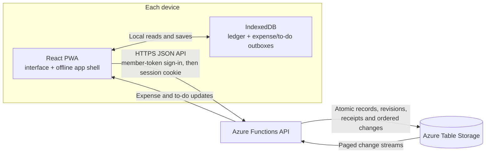

[](https://github.com/jetzlstorfer/splitty/actions/workflows/deploy.yml)

# Splitty

A private, offline-first expense ledger for two people. Record shared expenses in EUR, see who owes whom, and keep both devices in sync when you sign in.

<p align="center">
  
  &nbsp;&nbsp;
  
</p>

## At a glance

- Add expenses locally, split equally or enter exact and percentage shares.
- Track settlements, balances, and searchable history.
- Share expenses and household to-dos across two devices with member sign-in.
- Use the installable PWA offline; queued changes sync when a device reconnects.
- Import German or English Splitwise CSV exports and check the final balance before confirming.
- Categorize expenses automatically, switch between German and English, and download or restore backups.
- Optionally scan German/English receipts on-device, review suggestions, and download the scanner for offline use.

Insurance reminders are derived from health and pharmacy expenses; manual to-dos remain separate from the ledger and never affect balances.
Like expense rows, to-do rows open their details when selected. Use the checkbox at the left to complete or reopen a to-do; insurance reminders open the associated expense.

## How sync works

Each device saves changes to IndexedDB first, so recording an expense does not wait for the network. When online, the app sends queued changes to the same-origin API. The API stores versioned records and an ordered change log; devices pull updates to converge. Expenses and manual to-dos have separate outboxes and sync cursors.



Local-only use needs no account or Azure resources. Shared sync requires a backend. Browser storage can be cleared or evicted, so download a backup before replacing a device or clearing site data. This app is not end-to-end encrypted.

For conflict handling, data retention, and the full sync lifecycle, see [synchronization and deployment](docs/synchronization-and-deployment.md).

## Local receipt scanning

In a **new expense**, choose **Beleg scannen (optional) / Scan receipt (optional)**,
then **Scanner herunterladen / Download scanner**. The optional download is about
16 MB, hosted with Splitty rather than a third-party OCR service. It includes the
Tesseract.js WebAssembly runtime and German/English language data. Manual entry
does not download these assets and does not depend on the scanner.

Take a photo with the Android camera picker or choose a JPEG, PNG, or WebP image
under 20 MB. Use a sharp, upright photo cropped around the receipt. Processing
runs locally in a cancellable worker; keep the app open while scanning. Large
photos are resized before recognition. Speed and accuracy depend on the phone,
receipt layout, print quality, and lighting; this is best-effort autofill, not
reliable financial document understanding.

Review the suggested merchant, date, total, currency, and any warnings. **Use
suggestions** copies identified fields into the editable expense form; fields
without a suggestion keep their existing value. Payer and split are unchanged.
Review/correct the form and explicitly **Save** it. Scanning, retrying, cancelling,
closing the form, or applying suggestions never creates an expense on its own.
Low-confidence text and ambiguous totals/dates are left for manual entry.
Recognized text is available for inspection while the form is open.

The ledger remains EUR-only. A detected foreign or mixed currency never fills
the amount; enter a converted EUR amount manually. If no currency is recognized,
confirm that the receipt is in EUR before applying its total. No exchange rates
or automatic currency conversion are provided.

After the scanner download and app service-worker activation, scanning works
offline, including after an offline reload. The OCR assets use a separate cache
and are excluded from the normal app-shell download. Clearing or evicting browser
storage requires another download. Offline behavior requires a production build;
the Vite development server is for online development. If downloading or scanning
fails, an error is shown and manual entry remains available.

Splitty never uploads or persists receipt photos or OCR text, and provides no
receipt-image sharing or retrieval endpoint. The camera/gallery may retain its
own original photo outside Splitty. Only the confirmed expense fields enter the
existing household sync and backups. There is no cloud OCR fallback, OCR API key,
per-scan OCR charge, or added receipt storage; normal static hosting/download
costs still apply. Use a trusted device with a screen lock, as with the ledger.

The build serves the pinned OCR packages under `receipt-ocr-v1`, including their
runtime license notices. When updating the runtime or language packages, bump
the asset/cache version in `src\receiptAssets.ts`, the service-worker route in
`vite.config.ts`, and the fallback exclusion in `public\staticwebapp.config.json`
together so cached assets cannot mix incompatible versions.

## Run locally

Use Node.js 22.13+ or 24+ and npm:

```powershell
npm ci
npm ci --prefix api
npm run dev
```

Open <http://127.0.0.1:5173>. The frontend works on its own; without a backend, entries stay in that browser. If your environment requires the approved Microsoft npm proxy, use `npm run setup:approved` instead of the two install commands.

For local sign-in and sync, copy `api\local.settings.example.json` to `api\local.settings.json`, replace both member-token placeholders with independent random values, and run these in separate terminals:

```powershell
# Local Azure Table Storage emulator
.\api\node_modules\.bin\azurite-table.cmd --silent --skipApiVersionCheck --location .\.azure\azurite

# API and frontend
npm --prefix api run dev
npm run dev
```

Generate a token with `node -e "console.log(require('node:crypto').randomBytes(32).toString('base64url'))"`. Keep tokens private and give each member only their own. Never commit `local.settings.json`, exports, or backups.

## Import a Splitwise export

Open **Search → Import** and choose a two-person EUR group export. Review the preview and final-balance check before confirming. Splitty preserves each member's signed balance contributions as exported; it does not guess original payers or split details. Re-importing a complete export skips already imported rows.

See [import details](docs/importing.md) for duplicate handling, reconciliation, and limitations.

## Deploy

The Azure resources are described in [`infra/main.bicep`](infra/main.bicep); deployment is not automatic resource provisioning. In brief:

1. Generate two private member tokens and choose a stable household ID.
2. Deploy the Bicep template to create the Static Web App and Table Storage account.
3. Configure the Static Web App deployment secret `AZURE_STATIC_WEB_APPS_API_TOKEN` in the GitHub `production` environment.
4. Push or merge to `main` to run [Deploy to Azure](.github/workflows/deploy.yml), then sign in on each device.

Table Storage and operations may incur charges. Review current regional pricing and configure budget alerts; alerts are not spending limits.

## Checks

```powershell
npm run lint
npm test
npm run build
npm run build:api
```

The API integration and browser tests use synthetic households. To run the browser suite, start the local Table emulator in a separate terminal, then run:

```powershell
npx playwright install chromium
npm run test:e2e
```

See [browser validation](.github/skills/browser-validation/SKILL.md) and [offline-sync validation](.github/skills/offline-sync-validation/SKILL.md) for focused test setup. See [Copilot instructions](.github/copilot-instructions.md) for repository conventions.

Receipt browser checks use generated, non-personal receipt images and the real
local OCR engine. They cover editable suggestions, currency safeguards, retries,
cancellation, download failures, and scanning again after an offline reload.

For the local API, emulator, and registry setup, see [development](docs/development.md).
