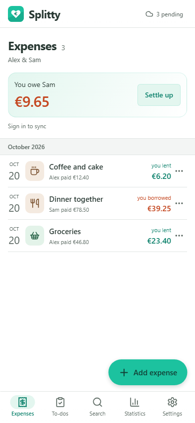
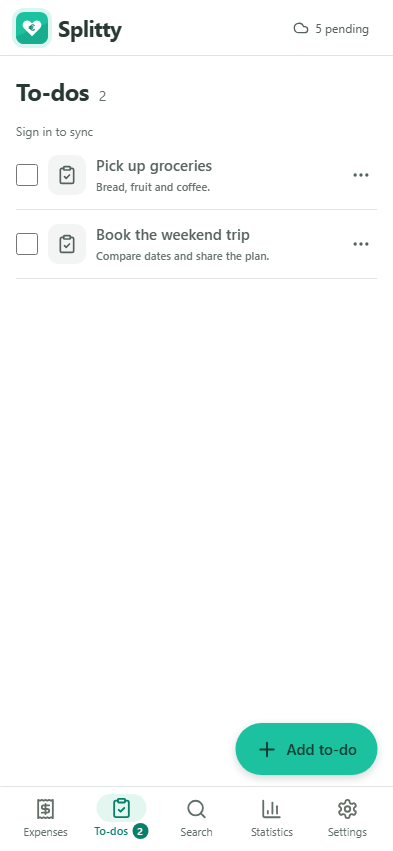
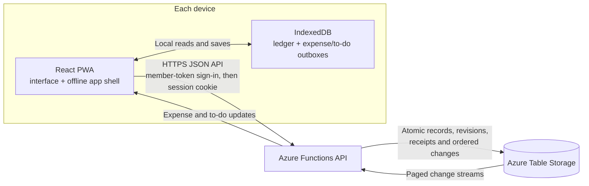

[](https://github.com/jetzlstorfer/splitty/actions/workflows/deploy.yml)

# Splitty

A private, offline-first expense ledger for two people. Record shared expenses in EUR, see who owes whom, and keep both devices in sync when you sign in.

The screenshots below show the expenses and to-do screens with synthetic sample data in light mode. The empty expenses screen introduces splitting, balances, and offline saving, with a hint for syncing devices. Default household labels are gender-neutral; set your own names in Settings or use your configured household names when signing in.

<p align="center">
  
  &nbsp;&nbsp;
  
</p>

## At a glance

- Add expenses locally, split equally or enter exact and percentage shares.
- Track settlements, balances, and searchable history.
- Share expenses and household to-dos across two devices with member sign-in.
- Install the PWA from the app on supported Android browsers; on iPhone, use **Install** for the browser's Add to Home Screen steps. The button disappears after installation. The app works offline; queued changes sync when a device reconnects.
- Import German or English Splitwise CSV exports and check the final balance before confirming.
- Categorize expenses automatically, switch between German and English, and download or restore backups.
- Optionally scan German/English receipts on-device, review suggestions, and download the scanner for offline use.

By default, new health and pharmacy receipts create insurance reminders. Either member can turn **Settings → To-dos → Automatic insurance to-dos** off for the household. This applies to newly entered receipts and CSV imports, not to existing reminders or their completion status. Turning it back on does not create reminders for skipped receipts. An offline device uses its last known setting until it syncs. Manual to-dos remain separate from the ledger and never affect balances.
Like expense rows, to-do rows open their details when selected. Use the checkbox at the left to complete or reopen a to-do; insurance reminders open the associated expense.
Open to-dos and insurance reminders are initially shown newest first, using the creation date for manual to-dos and the expense date for reminders. Drag a manual to-do by its grip handle, or focus the handle and use the arrow keys, to reorder manual to-dos; the order syncs to the whole household. Insurance reminders remain in their date-based slots while manual to-dos move around them.

Dropdowns, date selection, confirmations, and validation messages use Splitty's theme in both light and dark mode. Dates can also be typed as `YYYY-MM-DD`. The device keyboard, file picker, and permission prompts remain system-provided.

On iPhone in dark mode, the installed app draws its themed surface behind the notch with a transparent status bar. Light mode keeps the default status bar with dark icons. After updating or changing the device theme, fully close and reopen the Home Screen app so iOS picks up the status-bar settings.

The installed Android app uses a dark launch and system-navigation fallback to avoid a white strip below the page in dark mode. Some Android/Chrome versions use this fixed installed color even in light mode; the page and supported browser chrome still follow the device theme.

The Android shell updates separately from the page. First accept Splitty's **Update** prompt to activate the latest service worker. Then, in Chrome, open `chrome://webapks`, find Splitty, and select **Update**. Close all Splitty windows and connect the phone to Wi-Fi and power while Chrome updates the installed shell. Reload that diagnostics page and wait for **Successful**; the theme and background colors should both be `rgba(28,37,36,1)`. Reopen Splitty afterwards. This does not require reinstalling or clearing saved data. The manifest is fetched from the network rather than the offline app cache, so shell updates can receive new colors independently of the page version.

Choose who paid with the two-person switch directly in the expense form. For quick entry, use the keyboard's Next action after the description, then Done after the amount to save with today's date and the current payer and split. Date, category, and custom splits remain editable before saving.

When a new app version is ready, a prominent green card above the current page offers an **Update** button. Updating keeps your saved entries.

## How sync works

Each device saves changes to IndexedDB first, so recording an expense does not wait for the network. When online, the app sends queued changes to the same-origin API. The API stores versioned records and an ordered change log; devices pull updates to converge. Expenses and manual to-dos have separate outboxes and sync cursors.

Select the cloud indicator in the top-right corner for sync status, connection details, pending changes, and the last successful sync in the current session. It shows **Up-to-date** (**Aktuell** in German) with a check inside the cloud only when everything is synced. During synchronization, two arrows spin inside the cloud (static when reduced motion is preferred). All states share one cloud outline, with a clock for waiting changes, an exclamation mark for attention, and a cross when offline, alongside distinct labels. This popover is also where you sign in or out, sync manually, inspect errors, and resolve conflicting expense or to-do edits. It remains available while syncing or offline; close it with Escape, its close button, or a click outside.



Local-only use needs no account or Azure resources. Shared sync requires a backend. Browser storage can be cleared or evicted, so download a backup before replacing a device or clearing site data. This app is not end-to-end encrypted.

Settings shows your sign-in method and the name, email address, and photo supplied at sign-in. When Entra doesn't identify the provider in the ID token, Splitty checks the signed-in user's [sign-in identities](https://learn.microsoft.com/en-us/graph/api/resources/objectidentity) once at login. It uses a provider only if the account identities indicate one unambiguous method. It never guesses from the email address. With linked accounts, the method can remain unavailable if Entra omits it for that session.

To enable this fallback in an external tenant, open the **Splitty web app registration → API permissions**, add Microsoft Graph **delegated** `User.Read` and grant admin consent for the tenant. No application or directory-wide permission is needed. Splitty reads only `/me?$select=identities` and does not store the Graph token or identity list. Missing consent or an unavailable Graph endpoint does not prevent sign-in. A fresh sign-in is needed after enabling the permission or upgrading an older session.

For conflict handling, data retention, and the full sync lifecycle, see [synchronization and deployment](docs/synchronization-and-deployment.md).

For the shared multi-household design and Azure cost outlook, see the [multi-tenant plan](docs/multi-tenant-plan.md). The code includes Entra-based accounts, existing-household claims, local-history adoption, household-scoped sessions and storage, invitations, lifecycle controls, and quota/rate enforcement; public sign-up is not production-ready until migration is rehearsed and scheduled backup/deletion, provider validation, and operational/legal review are complete.

## Public legal pages

`/privacy` and `/terms` are public, sign-in-free pages linked from the app. Direct visits do not open the ledger or call the API. German is the default; use `?lang=en` or the language links for English. App links preserve the selected language. The existing SPA fallback serves direct visits to either URL.

These pages do not enable account sign-in or public registration.

## Local receipt scanning

In a **new expense**, choose **Beleg scannen (optional) / Scan receipt (optional)**,
then **Scanner herunterladen / Download scanner**. The optional download is about
16 MB, hosted with Splitty rather than a third-party OCR service. It includes the
Tesseract.js WebAssembly runtime and German/English language data. Manual entry
does not download these assets and does not depend on the scanner.

Take a photo with the Android camera picker or choose a JPEG, PNG, or WebP image
under 20 MB. Use a sharp, upright photo cropped around the receipt. Processing
runs locally in a cancellable worker; keep the app open while scanning. Large
photos are resized before recognition. Speed and accuracy depend on the phone,
receipt layout, print quality, and lighting; this is best-effort autofill, not
reliable financial document understanding.

Review the suggested merchant, date, total, currency, and any warnings. **Use
suggestions** copies identified fields into the editable expense form; fields
without a suggestion keep their existing value. Payer and split are unchanged.
Review/correct the form and explicitly **Save** it. Scanning, retrying, cancelling,
closing the form, or applying suggestions never creates an expense on its own.
Low-confidence text and ambiguous totals/dates are left for manual entry.
Recognized text is available for inspection while the form is open.

The ledger remains EUR-only. A detected foreign or mixed currency never fills
the amount; enter a converted EUR amount manually. If no currency is recognized,
confirm that the receipt is in EUR before applying its total. No exchange rates
or automatic currency conversion are provided.

After the scanner download, scanning works offline once the app's service worker
controls the page, which happens from the next app load after installation, and
continues to work after an offline reload. The OCR assets use a separate cache
and are excluded from the normal app-shell download. Clearing or evicting browser
storage requires another download. Offline behavior requires a production build;
the Vite development server is for online development. If downloading or scanning
fails, an error is shown and manual entry remains available.

Splitty never uploads or persists receipt photos or OCR text, and provides no
receipt-image sharing or retrieval endpoint. The camera/gallery may retain its
own original photo outside Splitty. Only the confirmed expense fields enter the
existing household sync and backups. There is no cloud OCR fallback, OCR API key,
per-scan OCR charge, or added receipt storage; normal static hosting/download
costs still apply. Use a trusted device with a screen lock, as with the ledger.

The build serves the pinned OCR packages under `receipt-ocr-v1`, including their
runtime license notices. When updating the runtime or language packages, bump
the asset/cache version in `src\receiptAssets.ts`, the service-worker route in
`vite.config.ts`, and the fallback exclusion in `public\staticwebapp.config.json`
together so cached assets cannot mix incompatible versions.

## Run locally

Use Node.js 22.13+ or 24+ and npm:

```powershell
npm ci
npm ci --prefix api
npm run dev
```

Open <http://127.0.0.1:5173>. The frontend works on its own; without a backend, entries stay in that browser. If your environment requires the approved Microsoft npm proxy, use `npm run setup:approved` instead of the two install commands.

For local sign-in and sync, copy `api\local.settings.example.json` to `api\local.settings.json`, replace both member-token placeholders with independent random values, and run these in separate terminals:

```powershell
# Local Azure Table Storage emulator
.\api\node_modules\.bin\azurite-table.cmd --silent --skipApiVersionCheck --location .\.azure\azurite

# API and frontend
npm --prefix api run dev
npm run dev
```

Generate a token with `node -e "console.log(require('node:crypto').randomBytes(32).toString('base64url'))"`. Keep tokens private and give each member only their own. Never commit `local.settings.json`, exports, or backups.

To try the app with a synthetic, pre-populated household of expenses and to-dos (no settings needed), run `npm run dev:seeded` and open <http://127.0.0.1:5174>. See [seeded local session](docs/development.md#seeded-local-session) for sign-in tokens and options.

## Import a Splitwise export

Open **Search → Import** and choose a two-person EUR group export. Review the preview and final-balance check before confirming. Splitty preserves each member's signed balance contributions as exported; it does not guess original payers or split details. Re-importing a complete export skips already imported rows.

See [import details](docs/importing.md) for duplicate handling, reconciliation, and limitations.

## Deploy

The Azure resources are described in [`infra/main.bicep`](infra/main.bicep); deployment is not automatic resource provisioning. In brief:

1. For a new hosted deployment, create an Entra External ID user flow and confidential web application. Register `https://<static-web-app-host>/api/auth/callback` as its redirect URI. Set `entraAuthority` to the HTTPS CIAM URL with the tenant ID or domain path (for example, `https://<tenant-subdomain>.ciamlogin.com/<tenant-id>`), supply `entraClientId` and secure `entraClientSecret`.
2. Deploy the Bicep template only when creating new Azure resources. For an existing production deployment, do not redeploy this template or replace its storage account as part of the application cutover.
3. Configure the Static Web App deployment secret `AZURE_STATIC_WEB_APPS_API_TOKEN` in the GitHub `production` environment.
4. Push or merge to `main` to run [Deploy to Azure](.github/workflows/deploy.yml), then sign in on each device.

### Existing household production cutover

The cutover uses the current Static Web App, custom domain, Table Storage account,
and `TABLE_STORAGE_CONNECTION_STRING`; it must not create a replacement ledger.
Before changing settings, sync both existing devices, resolve conflicts, and
download a backup from each device. Keep the current `HOUSEHOLD_ID`,
`MEMBER_A_TOKEN`, and `MEMBER_B_TOKEN` settings during the migration.

In the existing Static Web App's application settings, keep `APP_ORIGIN` set to
the current HTTPS custom domain, add the three `ENTRA_*` settings described
above, and set `ALLOW_NEW_HOUSEHOLDS=false`. Leave all table-storage settings
unchanged. Register the callback as
`https://<production-custom-domain>/api/auth/callback`. New users can then
claim a member slot by entering its existing member token before continuing
with Entra; the token is validated before redirect and only its digest is held
for the short-lived sign-in transaction. Household data remains in its
existing partition, and cached entries, queued writes, conflicts, tombstones,
and separate sync cursors are adopted into that account's local database
without deleting the original local database.

Have each existing member use their own token on a trusted device, complete
provider sign-in with the intended Entra account, and verify the household
names, balances, expenses, to-dos, and sync status on both devices. Do not
remove the legacy settings until both memberships are claimed and verified.
Afterward, remove `HOUSEHOLD_ID`, `MEMBER_A_TOKEN`, and `MEMBER_B_TOKEN`
together. Keep `ALLOW_NEW_HOUSEHOLDS=false` until backup/deletion operations,
provider checks, budgets, and reviewed legal pages are ready; only then set it
to `true` to permit public household creation. Non-local deployments default
to closed registration if this setting is absent.

For an isolated staging deployment, set `storageAuthMode` to `rbac` and provide
the workforce-tenant service principal's tenant ID, client ID, secret, and object
ID. The template assigns **Storage Table Data Contributor** at the staging
storage-account scope and disables shared-key access for that account. Keep the
staging identity and credentials separate from the External ID sign-in
application; do not use this mode for production until its deployment settings
are intentionally migrated. The default `connectionString` mode preserves the
existing deployment behavior.

Pull requests run the full [Check workflow](.github/workflows/check.yml), including API integration and browser tests. Automatic deployments on `main` repeat lint, unit tests, TypeScript checks, builds, and API integration tests, but skip browser installation and tests. Manual deployments run the full suite. Deployment only starts after all enabled checks pass. Use pull requests for changes to `main`: direct pushes also skip browser tests.

Table Storage and operations may incur charges. Review current regional pricing and configure budget alerts; alerts are not spending limits.

## Checks

```powershell
npm run lint
npm test
npm run check:e2e
npm run build
npm run build:api
```

The API integration and browser tests use synthetic households. After building, run the browser suite with:

```powershell
npx playwright install chromium webkit
npm run test:e2e
```

Browser fixtures automatically start private Table emulators and production previews
on available loopback ports. Every test gets a fresh household; no existing local
servers, settings, credentials, or data are reused. Chromium runs the main suite;
WebKit runs focused mobile/PWA and themed-control tests. See [development](docs/development.md#checks)
for focused commands and coverage ownership.

The suite uses two workers and stops after the first failure. Use
`npm run test:e2e -- --max-failures=0` to collect all failures.

For just the themed-control regressions in Safari's engine, run
`npm run test:e2e -- --project=webkit controls.spec.ts`. These cover mobile touch and
keyboard behavior in both themes; WebKit emulation does not replace testing on a
physical iPhone.

See [browser validation](.github/skills/browser-validation/SKILL.md) and [offline-sync validation](.github/skills/offline-sync-validation/SKILL.md) for focused test setup. See [Copilot instructions](.github/copilot-instructions.md) for repository conventions.

Receipt browser checks use generated, non-personal receipt images and the real
local OCR engine. They cover editable suggestions, currency safeguards, retries,
cancellation, download failures, and scanning again after an offline reload.

For the local API, emulator, and registry setup, see [development](docs/development.md).

## Dependency updates

[Dependabot](.github/dependabot.yml) groups monthly npm version updates for the
frontend and API. Routine releases must be at least seven days old at the scheduled
check. npm security updates use a separate group and wait for neither the cooldown
nor the monthly schedule. GitHub Actions version updates have their own monthly group.

Keep frontend and API TypeScript versions aligned. TypeScript upgrades must satisfy
the `typescript-eslint` peer dependency range; retain TypeScript 5.7 until a
compatible compiler upgrade is validated rather than bypassing peer checks.
