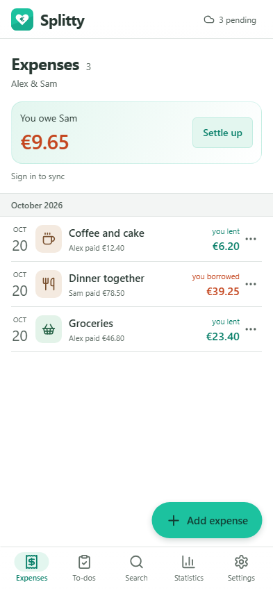
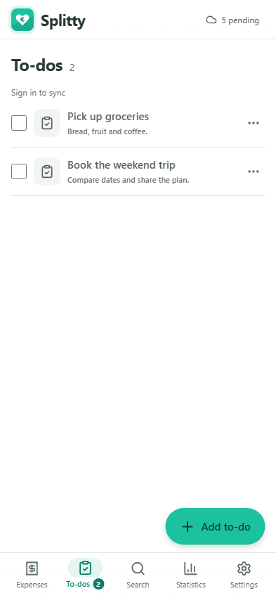
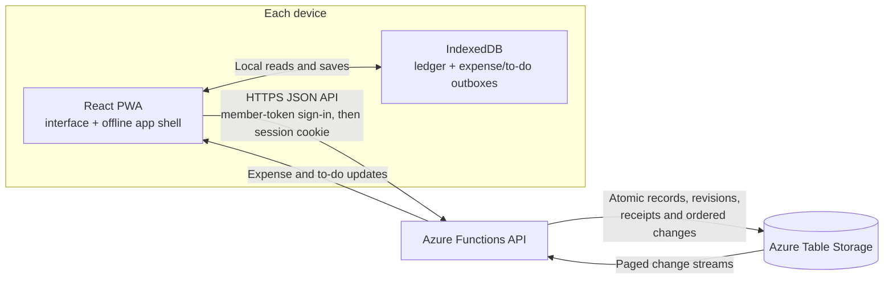

[](https://github.com/jetzlstorfer/splitty/actions/workflows/deploy.yml)

# Splitty

A private, offline-first expense ledger for two people. Record shared expenses in EUR, see who owes whom, and keep both devices in sync when you sign in.

<p align="center">
  
  &nbsp;&nbsp;
  
</p>

## At a glance

- Add expenses locally, split equally or enter exact and percentage shares.
- Track settlements, balances, and searchable history.
- Share expenses and household to-dos across two devices with member sign-in.
- Use the installable PWA offline; queued changes sync when a device reconnects.
- Import German or English Splitwise CSV exports and check the final balance before confirming.
- Categorize expenses automatically, switch between German and English, and download or restore backups.

Insurance reminders are derived from health and pharmacy expenses; manual to-dos remain separate from the ledger and never affect balances.
Like expense rows, to-do rows open their details when selected. Use the checkbox at the left to complete or reopen a to-do; insurance reminders open the associated expense.

Dropdowns, date selection, confirmations, and validation messages use Splitty's theme in both light and dark mode. Dates can also be typed as `YYYY-MM-DD`. The device keyboard, file picker, and permission prompts remain system-provided.

When a new app version is ready, a prominent green card above the current page offers an **Update** button. Updating keeps your saved entries.

## How sync works

Each device saves changes to IndexedDB first, so recording an expense does not wait for the network. When online, the app sends queued changes to the same-origin API. The API stores versioned records and an ordered change log; devices pull updates to converge. Expenses and manual to-dos have separate outboxes and sync cursors.

Select the cloud indicator in the top-right corner for sync status, connection details, pending changes, and the last successful sync in the current session. This popover is also where you sign in or out, sync manually, inspect errors, and resolve conflicting expense or to-do edits. It remains available while syncing or offline; close it with Escape, its close button, or a click outside.



Local-only use needs no account or Azure resources. Shared sync requires a backend. Browser storage can be cleared or evicted, so download a backup before replacing a device or clearing site data. This app is not end-to-end encrypted.

For conflict handling, data retention, and the full sync lifecycle, see [synchronization and deployment](docs/synchronization-and-deployment.md).

## Run locally

Use Node.js 22.13+ or 24+ and npm:

```powershell
npm ci
npm ci --prefix api
npm run dev
```

Open <http://127.0.0.1:5173>. The frontend works on its own; without a backend, entries stay in that browser. If your environment requires the approved Microsoft npm proxy, use `npm run setup:approved` instead of the two install commands.

For local sign-in and sync, copy `api\local.settings.example.json` to `api\local.settings.json`, replace both member-token placeholders with independent random values, and run these in separate terminals:

```powershell
# Local Azure Table Storage emulator
.\api\node_modules\.bin\azurite-table.cmd --silent --skipApiVersionCheck --location .\.azure\azurite

# API and frontend
npm --prefix api run dev
npm run dev
```

Generate a token with `node -e "console.log(require('node:crypto').randomBytes(32).toString('base64url'))"`. Keep tokens private and give each member only their own. Never commit `local.settings.json`, exports, or backups.

## Import a Splitwise export

Open **Search → Import** and choose a two-person EUR group export. Review the preview and final-balance check before confirming. Splitty preserves each member's signed balance contributions as exported; it does not guess original payers or split details. Re-importing a complete export skips already imported rows.

See [import details](docs/importing.md) for duplicate handling, reconciliation, and limitations.

## Deploy

The Azure resources are described in [`infra/main.bicep`](infra/main.bicep); deployment is not automatic resource provisioning. In brief:

1. Generate two private member tokens and choose a stable household ID.
2. Deploy the Bicep template to create the Static Web App and Table Storage account.
3. Configure the Static Web App deployment secret `AZURE_STATIC_WEB_APPS_API_TOKEN` in the GitHub `production` environment.
4. Push or merge to `main` to run [Deploy to Azure](.github/workflows/deploy.yml), then sign in on each device.

Table Storage and operations may incur charges. Review current regional pricing and configure budget alerts; alerts are not spending limits.

## Checks

```powershell
npm run lint
npm test
npm run check:e2e
npm run build
npm run build:api
```

The API integration and browser tests use synthetic households. After building, run the browser suite with:

```powershell
npx playwright install chromium webkit
npm run test:e2e
```

Browser fixtures automatically start private Table emulators and production previews
on available loopback ports. Every test gets a fresh household; no existing local
servers, settings, credentials, or data are reused. Chromium runs the main suite;
WebKit runs focused mobile/PWA and themed-control tests. See [development](docs/development.md#checks)
for focused commands and coverage ownership.

For just the themed-control regressions in Safari's engine, run
`npm run test:e2e -- --project=webkit controls.spec.ts`. These cover mobile touch and
keyboard behavior in both themes; WebKit emulation does not replace testing on a
physical iPhone.

See [browser validation](.github/skills/browser-validation/SKILL.md) and [offline-sync validation](.github/skills/offline-sync-validation/SKILL.md) for focused test setup. See [Copilot instructions](.github/copilot-instructions.md) for repository conventions.

For the local API, emulator, and registry setup, see [development](docs/development.md).
